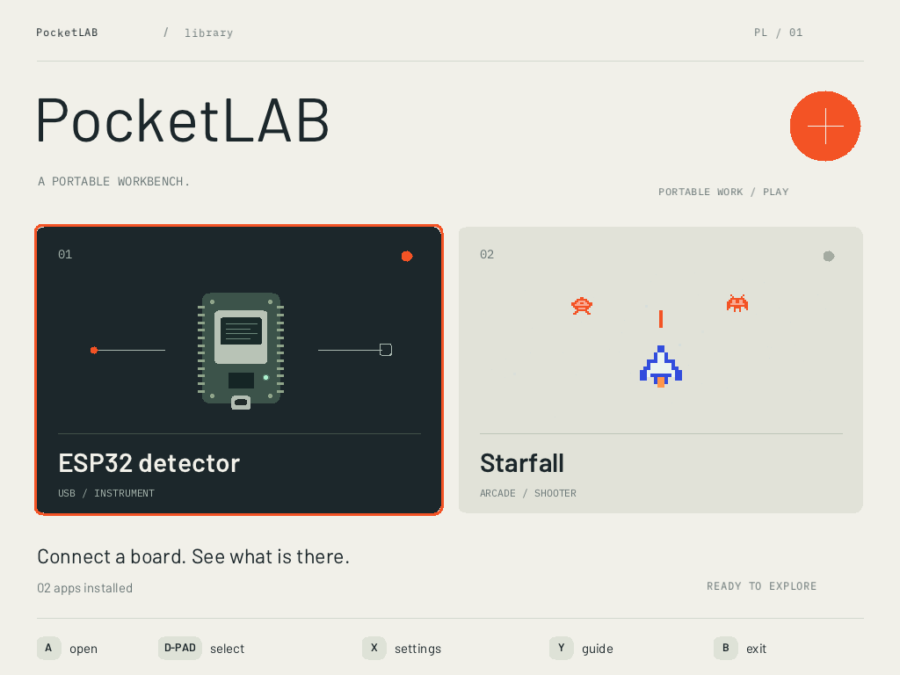

# PocketLAB for TrimUI Brick Pro

**Create mini apps for your Brick Pro with your coding agent.**

PocketLAB is a small app library for the **TrimUI Brick Pro (TG4040)**. It runs inside the stock OS and opens from **Apps → PocketLAB**. It comes with two apps: **ESP32 detector**, for inspecting USB boards, and **Starfall**, an offline space shooter. After that, you describe new mini apps to your coding agent, and it builds them and sends them to the Brick over USB.

PocketLAB never replaces firmware, formats your card on its own, or touches your games and saves. Everything lives in `Apps/PocketLab` on the SD card.

## What you need

- **A TrimUI Brick Pro (TG4040) running TrimUI's stock OS.** PocketLAB is an app for that OS. It does not run on custom firmware or other operating systems for the Brick.
- **The Brick's SD card and a card reader, for setup only.** You use them to install or update PocketLAB. After that, the card stays in the Brick.
- **A USB-C data cable, for making mini apps.** Your agent builds apps on your computer and sends them to the Brick through its bottom USB-C port. You don't take the SD card out again.



## Set up with your coding agent

1. Turn the Brick off, take out its SD card, and put the card in your computer's card reader.
2. Paste this into a coding agent that can run commands on your computer, such as Claude Code, Codex, Cursor or Devin:

```text
Set up PocketLAB on my TrimUI Brick Pro. Clone
https://github.com/saivishnu2299/pocketlab and follow the setup steps
in its AGENTS.md. If my SD card is already a working Brick Pro card,
keep every existing file on it: only add or update Apps/PocketLab,
and never format, erase or replace anything else on the card.
```

The agent finds your card, installs or updates PocketLAB, verifies every file and ejects the card. Then put the card back in the Brick, turn it on and open **Apps → PocketLAB**.

A cloud-only agent can't reach your card reader, so use one that runs on your computer.

## Set up yourself

**Any computer, no tools:** download `PocketLAB-<version>-device.zip` from [Releases](https://github.com/saivishnu2299/pocketlab/releases), or use **Code → Download ZIP** on this page and open its `runtime` folder. Copy the `Apps/PocketLab` folder into the `Apps` folder on your card, so that `Apps/PocketLab/launch.sh` exists. Do this only for a first install. To update, use the commands below, which keep your apps and saves.

**macOS or Linux terminal:** this needs Python 3.9 or newer, which macOS includes.

```sh
git clone https://github.com/saivishnu2299/pocketlab
cd pocketlab
./pocketlab cards                          # finds your card and prints the command for it
./pocketlab setup --sd /Volumes/YOUR_CARD --eject
```

`setup` copies only `Apps/PocketLab`, checks every file against its SHA-256 manifest and keeps a rollback copy when it updates. A blank card needs the official TrimUI files first; `cards` tells you if it does. See the [installation guide](docs/INSTALL.md) for blank cards, USB installs and recovery.

## Make your own app

Mini apps are built and installed over USB, not through the SD card, so leave the card in the Brick. Connect the Brick's **bottom USB-C port** to your computer with a data cable, open PocketLAB on the Brick, and keep the stock USB Storage app closed. The rear HOST port is for accessories such as ESP32 boards. Then give your agent a prompt like this, with your own description in place of the brackets:

```text
Read AGENTS.md and SDK.md. Create a PocketLAB mini app named "My app"
in miniapps/my-app that [describe what it does and how it should look].
Give it its own cover artwork, build and run it on my Brick over USB,
and tell me what to test.
```

Or do it yourself:

```sh
./pocketlab doctor --usb
./pocketlab new miniapps/my-app --name "My app"
./pocketlab run miniapps/my-app --usb      # build, upload and open on the Brick
./pocketlab watch miniapps/my-app --usb    # rebuild and reopen on every save
```

Building apps also needs Python 3.12+ and [ADB](docs/INSTALL.md#computer-prerequisites). The first build downloads a pinned compiler; you don't need Docker, a VM or a connected Brick to compile. Apps are native C/SDL2 programs with any look you like, and they keep working without the computer. Your app projects in `miniapps/` stay out of Git. The [PocketLAB SDK guide](SDK.md) covers the app contract.

## The included apps

- **ESP32 detector:** connect a board to the rear HOST USB-C port to see what is attached. It is careful to tell a serial bridge apart from a verified ESP32. An optional chip check, which you confirm on screen, may reset the board but never writes flash.
- **Starfall:** an offline shooter with original graphics and synthesized sound, three difficulties, a shield and saved high scores.

D-pad or left stick to select, **A** to open, **B** to go back, **X** for settings and **Y** for the guide. See the [device guide](docs/DEVICE.md) for complete controls.

## Status

PocketLAB requires TrimUI's stock OS on the TG4040 and has been tested on a real Brick Pro running firmware 1.1.1. No minimum firmware version has been established. Setup is tested on macOS (Apple Silicon); Linux is configured but less tested, and Windows users should use the device ZIP. Details are in [compatibility](docs/COMPATIBILITY.md), and untested areas are listed under [known limitations](docs/VALIDATION.md#known-limitations). If something goes wrong, see [troubleshooting](docs/TROUBLESHOOTING.md) or open an issue. Report security problems privately as described in [SECURITY.md](SECURITY.md).

## Develop PocketLAB itself

```sh
make host       # native preview; Clang and SDL2 development files required
make test       # core, protocol, installer, recovery and release checks
make brick      # device-independent ARM64 build
make renders    # deterministic scene renders and frozen-UI comparisons
make sdk-test   # generated app lifecycle and ARM build smoke test
```

See [CONTRIBUTING](CONTRIBUTING.md) and the [release procedure](docs/RELEASING.md).

PocketLAB is MIT licensed. Fonts and third-party components keep their own notices in [THIRD_PARTY.md](THIRD_PARTY.md). The artwork and sound are original. PocketLAB is an independent project and is not affiliated with TrimUI, which provides the stock OS and SD base.
